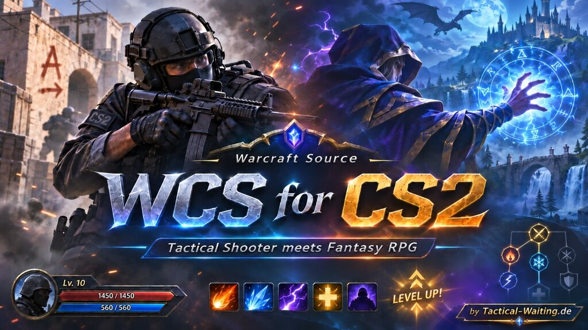

# WCS2 — Warcraft:Source for Counter-Strike 2

A data-driven **CounterStrikeSharp** (`.NET 10.0`) port of **Warcraft:Source (WCS)** by [ThaPwned](https://github.com/ThaPwned/WCS) for **Counter-Strike 2** on **Linux x64** dedicated servers.

> **Platform Support:** **Linux x86_64 dedicated servers only.** Native Source 2 collision tracing (`ElfSymbolResolver` + `Source2TraceEngine`) and the bundled `libe_sqlite3.so` binary target Linux x64.

## Features

- **11 Standard Races (47 Skills):**
  - Archmage Proudmoore, Blood Mage, Crypt Lord, Flame Predator, Human Alliance, Night Elves, Orcish Horde, Shadow Hunter, Succubus Hunter, Undead Scourge, Warden
- **4 Shop Items:** Belt of Vitality, Boots of Speed, Gem of Life, Rune of Wisdom
- **Core WCS Progression:** Per-race XP & levels (`required_xp = 80 * level`), Rested XP (online & offline accumulation), Level Bank (with new-player bonus), Bot random race & ability support, and full `wcsadmin` management
- **Source 2 Collision Tracing:** Automatic ELF64 RTTI/xref symbol resolution (`configs/gamedata.json` fallback/override) + standing/crouched player-hull validation prevents teleporting or spawning props inside walls, floors, ceilings, or solid props, plus an optional **Dash-style Teleport (`teleport_dash`)** alternative included in teleport race configs
- **Data-Driven Engine:** JSONC (comments & trailing commas supported) race & item configs (`configs/`) powered by composable skill primitives, bespoke custom handlers, and a bundled interactive terminal **Race Builder TUI** (`configs/races/wcs2-race-builder.py`)
- **Embedded SQLite Persistence:** Async WAL-mode SQLite database (`Microsoft.Data.Sqlite` + `Dapper`) auto-initialized on first boot
- **Interactive Menus:** Built on `CS2MenuManager` (`WasdMenu`, `CenterHtmlMenu`, `ChatMenu`, `ConsoleMenu`)

---

## Setup

For server administrators deploying `WCS2` on a **CS2 Linux x64** dedicated server using a prebuilt GitHub Release.

### 1. Prerequisites (Linux x64 CS2 Server)

- **[Counter-Strike 2 Dedicated Server](https://developer.valvesoftware.com/wiki/Counter-Strike_2/Dedicated_Servers)** on **Linux x86_64**
- **[Metamod:Source](https://www.sourcemm.net/downloads.php?branch=master)** `2.x` (`game/csgo/addons/metamod/` registered in `game/csgo/gameinfo.gi`)
- **[CounterStrikeSharp](https://github.com/roflmuffin/CounterStrikeSharp/releases)** `v1.0.381+` (**`with-runtime` Linux x64** release bundling the **.NET 10.0** runtime)
- **[CS2MenuManager](https://github.com/schwarper/CS2MenuManager/releases)** `v1.0.43+` extracted to `game/csgo/addons/counterstrikesharp/shared/CS2MenuManager/` (including `config.toml`; `WCS2` loads it automatically on startup and `wcs_reload` so WASD navigation hints `W/S`, `E`, `Shift`, `Tab` display without needing the optional `CS2MenuManager_MenuManager` plugin)

### 2. Download & Extract Prebuilt Release

1. Download the latest `WCS2-v1.0.7-linux-x64.zip` (or `.tar.gz`) archive from **[GitHub Releases](https://github.com/dAn0id/wcs2/releases)**.
2. Extract it into `game/csgo/addons/counterstrikesharp/plugins/` so the directory layout looks like:
   ```text
   game/csgo/addons/counterstrikesharp/
   ├── shared/
   │   └── CS2MenuManager/
   │       ├── CS2MenuManager.dll
   │       ├── CS2MenuManager.deps.json
   │       └── config.toml
   └── plugins/
       └── WCS2/
           ├── WCS2.dll
           ├── WCS2.deps.json
           ├── Dapper.dll
           ├── Microsoft.Data.Sqlite.dll
           ├── SQLitePCLRaw.batteries_v2.dll
           ├── SQLitePCLRaw.core.dll
           ├── SQLitePCLRaw.provider.e_sqlite3.dll
           ├── libe_sqlite3.so
           ├── defaults/
           │   └── configs/               # Shipped defaults (never overwrites configs/ on update)
           │       ├── wcs.json
           │       ├── gamedata.json
           │       ├── items.json
           │       └── races/
           │           ├── *.json
           │           └── wcs2-race-builder.py
           ├── configs/                   # Auto-seeded from defaults/configs/ on first boot
           │   ├── wcs.json
           │   ├── gamedata.json
           │   ├── items.json
           │   └── races/
           │       ├── archmage_proudmoore.json
           │       ├── blood_mage.json
           │       ├── crypt_lord.json
           │       ├── flame_predator.json
           │       ├── human_alliance.json
           │       ├── night_elves.json
           │       ├── orcish_horde.json
           │       ├── shadow_hunter.json
           │       ├── succubus_hunter.json
           │       ├── undead_scourge.json
           │       ├── warden.json
           │       └── wcs2-race-builder.py   # Interactive TUI race builder & validator
           └── data/                      # Auto-created on first boot
               └── wcs2.sqlite            # Fresh WAL-mode SQLite DB
   ```
3. Ensure all files are owned by the Linux user running your CS2 server (e.g. `chown -R <server-user>:<server-user> plugins/WCS2`).

> **Safe Updating:** Release archives ship default config templates under `defaults/configs/` and never include a `configs/` folder. On startup (and `wcs_reload`), `WCS2` copies only *missing* `.json` config files from `defaults/configs/` into `configs/` — so extracting a new release archive directly over `plugins/WCS2/` safely preserves all customized `wcs.json`, `gamedata.json`, `items.json`, `races/*.json`, and `data/wcs2.sqlite` files, while bundled `.py` tooling (`wcs2-race-builder.py`) automatically stays up to date.

### 3. Configure Admins

`WCS2` grants access to `!wcsadmin`, `wcs_reload`, and `wcs_tracetest` via **either** of two methods (you can use one or both):

1. **CounterStrikeSharp `admins.json` (Recommended):**
   Create/edit `game/csgo/addons/counterstrikesharp/configs/admins.json` and grant `@css/root` or `@wcs/admin`:
   ```json
   {
     "YourName": {
       "identity": "76561197960265728",
       "immunity": 100,
       "flags": [
         "@css/root",
         "@wcs/admin"
       ]
     }
   }
   ```
2. **Plugin config `plugins/WCS2/configs/wcs.json` (`admin_steam_ids`):**
   Replace the placeholder `76561197960265728` in `admin_steam_ids` with your own 17-digit **SteamID64** integer(s) (look up your SteamID64 via e.g. [steamid.io](https://steamid.io/)):
   ```json
   "admin_steam_ids": [
     76561197960265728
   ]
   ```

### 4. Customize Configs, Gamedata & Optional Dash Teleport

- **`configs/wcs.json`**: XP rates (`xp_interval`, `kill_xp`, `headshot_xp`, `knife_xp`, `round_win_xp`, etc.), Rested XP intervals, Level Bank new-player bonus, bot race behavior, menu style (`wasd`, `html`, `chat`, `console`), `allow_inspect_ultimate_bind`, `use_native_trace` (kill-switch for Source 2 native physics tracing; falls back to safe managed teleport when `false`), GitHub auto-updater settings (`update_check_enabled`, `github_repo`, and optional `github_token` — leave empty for public repos; only needed for private repos), and stock CS2 model paths.
- **`configs/gamedata.json`**: Controls how `Source2TraceEngine` resolves CS2 Linux x64 physics symbols (`TraceShape`, `GameTraceManager`, `CTraceFilter` vtable):
  - `"resolution_mode": "auto"` *(default)* — Automatically resolves all 3 symbols directly from `libserver.so` ELF64 metadata on disk (Itanium RTTI for `12CTraceFilter`, VProf string xref + `.eh_frame_hdr`/prologue for `"Physics/TraceShape (Server)"`, and caller consensus for `GameTraceManager`) so `WCS2` survives CS2 compiler updates without recompiling. Any symbol that cannot be resolved dynamically falls back to `linux_signatures` in `gamedata.json`.
  - `"resolution_mode": "dynamic"` — Dynamic ELF64 resolution only.
  - `"resolution_mode": "gamedata"` — Uses only `linux_signatures` from `gamedata.json` (admin override without recompiling).
- **`configs/items.json`**: Shop item pricing, buy limits, duration, and action lists.
- **`configs/races/*.json`**: One JSON file per race (`//` comments and trailing commas are supported).
- **Optional Dash-Style Teleport (`teleport_dash`):** Races with the `teleport` skill (such as `configs/races/human_alliance.json`) include a commented-out `"type": "teleport_dash"` alternative right next to `"teleport"` that launches the player forward with velocity + electric/distort particles instead of instant point-to-point teleport. To switch, comment out `"teleport"`, uncomment `"teleport_dash"`, and run `wcs_reload`.
- **Hot-Reload, Diagnostics & In-Game Updater:**
  - `wcs_reload` — Reloads `wcs.json`, `gamedata.json`, `items.json`, and all `races/*.json` live without restarting the server.
  - `wcs_tracetest` — Runs a live Source 2 Line + Player-BBox Hull diagnostic trace on the current map and logs symbol resolution sources and hit results.
  - `wcs_update_check` — Forces an async GitHub release check (`@css/root` / `admin_steam_ids` / server console). Root Admins also receive a once-per-map red chat alert on team join when a newer release exists and can download, SHA256-verify, atomically install (preserving `configs/` and `data/`), and trigger CounterStrikeSharp's native `FileSystemWatcher` hot-reload (requires `PluginHotReloadEnabled: true` in `core.json`, or a server restart if disabled) directly from **`!wcsadmin` -> `WCS2 Updates`**.

### 5. Start & Verify

Restart your CS2 server and verify in the server console / RCON:
- `meta list` -> `CounterStrikeSharp` loaded
- `css_plugins list` -> `[#1:LOADED]: "WCS2" (1.0.7)`
- Server startup logs confirm:
  - `[WCS2] Loaded 11 races across 3 categories.`
  - `[WCS2] Loaded 4 shop items.`
  - `[WCS2] SQLite database initialized cleanly.`
  - `[WCS2] Source2TraceEngine initialized cleanly (mode=auto): TraceShape=[dynamic-elf] ..., GTM*=[dynamic-elf] ..., FilterVtable=[dynamic-elf] ...`

### 6. In-Game Commands & Keybinds

#### Chat Commands (`!` public / `/` silent)
| Command | Description |
| --- | --- |
| `!wcs`, `!wcsmenu` | Open WCS main menu |
| `!changerace [name]` | Change your active race |
| `!spendskills` | Spend unused skill points |
| `!showskills`, `!myinfo` | Display current race skills & XP |
| `!resetskills` | Reset skill points for your current race |
| `!raceinfo [name]`, `!myraceinfo` | View race skill details |
| `!shopmenu`, `!shopinfo` | Buy or inspect WCS shop items |
| `!playerinfo` | Inspect online players' races & levels |
| `!wcsrank`, `!rank`, `!showxp` | Show your XP and server rank |
| `!wcstop` | Show WCS Top 10 leaderboard |
| `!wcsbank`, `!levelbank` | Manage & withdraw banked levels |
| `!wcshelp` | Print command help |
| `!wcsadmin` | Open WCS Admin menu (`@css/root` / `@wcs/admin` / `admin_steam_ids`) |

#### Console Commands & Recommended Binds
Players can bind their Ultimate and Ability keys in the CS2 console:
```text
bind v ultimate
bind c ability
```
- `ultimate` / `css_ultimate` — Activate your race's Ultimate skill. When `allow_inspect_ultimate_bind` is `true` in `wcs.json`, players can also opt in to triggering their Ultimate with the weapon inspect key (`F` / `+lookatweapon`).
- `ability` / `css_ability` — Activate your race's Ability skill (e.g. Shadow Hunter Serpent Ward).
- `wcs_reload` — Reload `wcs.json`, `gamedata.json`, `items.json`, and all `races/*.json` configs (admin / server console).
- `wcs_update_check` — Trigger an immediate async GitHub release check (`@css/root` / `admin_steam_ids` / server console).
- `wcs_tracetest` — Run a live Source 2 Line + Player-BBox Hull trace self-test (admin / server console).
- `wcs2_version` — Print the currently running `WCS2` version (server console / RCON / client console).

---

## Creating Custom Races

`WCS2` is fully data-driven: server admins can create new races (or edit existing ones) purely in JSON without writing C# or recompiling — either with the bundled **interactive TUI Race Builder** or by editing JSON directly.

### Interactive TUI Race Builder (`wcs2-race-builder.py`)

`WCS2` ships a zero-dependency Python 3 (`curses`) interactive wizard directly inside `configs/races/` for creating, editing, and validating custom races over SSH or a local terminal:

```bash
cd game/csgo/addons/counterstrikesharp/plugins/WCS2/configs/races
./wcs2-race-builder.py
```

- **Guided 3-Step Wizard:** Create a brand-new race or load & edit any existing `*.json` file in `configs/races/` — pick triggers, browse all **40 built-in primitives** and **6 custom handlers**, configure targets, linearly interpolate `level_values` (`Start -> End`), preview live validated JSON, and save directly as `./<race_key>.json`.
- **Activate Live:** After saving, run `wcs_reload` in your CS2 server console / RCON to load the new race without restarting.
- **Useful CLI Options:**
  ```bash
  ./wcs2-race-builder.py --load human_alliance.json   # Open an existing race directly in the TUI
  ./wcs2-race-builder.py --list-skills                # Print all 40 primitives & 6 custom handlers
  ./wcs2-race-builder.py --validate *.json            # Validate one or more race JSON/JSONC files
  ```

### 1. Where to Add Custom Races & Hot-Reload

1. Create a new JSON file under `game/csgo/addons/counterstrikesharp/plugins/WCS2/configs/races/<race_key>.json` (for example `frost_assassin.json`).
   - Your custom files in `configs/races/` are **never overwritten** when updating `WCS2`.
   - Standard JSON plus **`//` line comments**, `/* ... */` block comments, and **trailing commas** are supported.
2. Run **`wcs_reload`** in the server console (or via RCON / admin console) to load your new race live without restarting the server.
   - Check the server log for `[WCS2] Loaded <N> races across <M> categories.` to confirm your file parsed cleanly.

### 2. Copy-Paste Example Race

Save as `plugins/WCS2/configs/races/frost_assassin.json`:

```jsonc
{
  "key": "frost_assassin",
  "name": "Frost Assassin",
  "author": "ServerAdmin",
  "description": "Fast, stealthy striker with frost slows and an electric dash.",
  "required_level": 0,      // Total player level required to pick this race (0 = unlocked)
  "max_level": 0,           // Max race level (0 = uncapped)
  "team_limit": 0,          // Max players per team on this race (0 = unlimited)
  "restrict_team": 0,       // 0 = both teams, 2 = T only, 3 = CT only
  "categories": ["Custom races", "All races"],
  "allowed_weapons": [],    // Optional allowlist, e.g. ["weapon_knife", "weapon_p250", "weapon_c4"]
  "restricted_weapons": [], // Optional denylist when allowed_weapons is empty, e.g. ["weapon_awp"]

  // Optional race-level lifecycle actions (also supports death_actions, round_start_actions, round_end_actions)
  "spawn_actions": [
    {
      "type": "beam_ring",
      "target": "self",
      "params": { "radius": 70, "r": 120, "g": 220, "b": 255, "width": 5, "duration": 1.5, "z_offset": 15 }
    }
  ],

  "skills": [
    {
      "key": "frost_cloak",
      "name": "Frost Cloak",
      "description": "Grants stealth and faster movement on spawn.",
      "trigger": "PlayerSpawn",
      "max_level": 5,
      "required_level": 0,  // Race level required to invest points in this skill
      "actions": [
        {
          "type": "invisibility",
          "target": "self",
          "delay": 0.5,
          "level_values": { "alpha": [230, 205, 180, 155, 130] },
          "params": { "message": "Frost Cloak - {pct}% invisible." }
        },
        {
          "type": "speed",
          "target": "self",
          "level_values": { "value": [1.10, 1.15, 1.20, 1.25, 1.30] },
          "params": { "mode": "set", "source": "frost_cloak" }
        }
      ]
    },
    {
      "key": "chilling_blade",
      "name": "Chilling Blade",
      "description": "Chance on hit to slow your target and deal bonus damage.",
      "trigger": "PlayerAttacker",
      "max_level": 5,
      "required_level": 0,
      "chances": [10, 14, 18, 22, 26], // Proc chance % per skill level (empty = 100%)
      "weapons": [],                   // Optional weapon filter, e.g. ["weapon_knife"] or ["weapon_hegrenade"]
      "actions": [
        {
          "type": "speed",
          "target": "victim",
          "level_values": {
            "value": [0.85, 0.80, 0.75, 0.70, 0.65],
            "duration": [1.0, 1.3, 1.6, 1.9, 2.2]
          },
          "params": {
            "mode": "set",
            "source": "chilling_blade",
            "prevent_stack_key": "is_slowed",
            "message": "Slowed {victim} for {duration}s!",
            "victim_message": "{attacker} slowed you for {duration}s!"
          }
        },
        {
          "type": "bonus_damage",
          "target": "victim",
          "level_values": { "min_damage": [4, 6, 8, 10, 12], "max_damage": [8, 10, 12, 15, 18] },
          "params": { "center_message": "Chilling Blade +{damage} damage!" }
        }
      ]
    },
    {
      "key": "frost_dash",
      "name": "Frost Dash",
      "description": "Launch yourself forward where you aim.",
      "trigger": "PlayerUltimate",
      "max_level": 5,
      "required_level": 5,
      "cooldowns": [8.0, 7.0, 6.0, 5.0, 4.0], // Cooldown in seconds per skill level
      "actions": [
        {
          "type": "teleport_dash",
          "target": "self",
          "level_values": { "force": [800, 950, 1100, 1250, 1400] },
          "params": {
            "z_boost": 150,
            "sound": "UIPanorama.equip_musicKit",
            "sound_volume": 0.5,
            "particle_count": 2
          }
        }
      ]
    }
  ]
}
```

### 3. Triggers, Targets, Scaling & Placeholders

- **How `level_values` vs `params` work:**
  - `level_values`: Dictionary of numeric arrays indexed by skill level (index `0` = level 1, index `1` = level 2, ..., clamped to the last element if the array is shorter than `max_level`). Example: `"level_values": { "amount": [10, 20, 30] }`.
  - `params`: Static constants (numbers, strings, booleans, `[r, g, b]` color arrays, or string arrays). Any numeric key accepted in `level_values` can also be set as a constant in `params`.
  - `delay`: Optional delay in seconds before an action executes (automatically cancelled if the round ends or player disconnects).
  - If a primary action fails to activate (e.g. teleport blocked, already frozen, insufficient cash, all enemies immune), trailing actions in the same skill are skipped and the ultimate/ability cooldown is refunded.
- **Valid `trigger` values** (enum names in `SkillTrigger`, case-insensitive):

| Trigger | Fires When |
| --- | --- |
| `PlayerSpawn` | Player spawns alive (race `spawn_actions` run first, then `PlayerSpawn` skills) |
| `PlayerAttacker` | Player deals non-skill weapon/grenade damage to an enemy |
| `PlayerVictim` | Player takes damage from an enemy (before damage resolves) |
| `PlayerDeath` | Player dies |
| `PlayerKill` | Player kills an enemy |
| `PlayerUltimate` | Player activates `ultimate` / `css_ultimate` (or inspect bind) |
| `PlayerAbility` | Player activates `ability` / `css_ability` |
| `PlayerRoundStart` | Round starts (race `round_start_actions` / matching skills) |
| `PlayerRoundEnd` | Round ends (race `round_end_actions` / matching skills) |
| `PlayerBuy` | Shop item instant purchase (`items.json`) |

- **Valid `target` selectors:**
  - Single-target: `"self"` (or `"owner"`), `"victim"`, `"attacker"`, `"enemy"` (resolves to the opposite player in combat).
  - Team / AoE: `"nearby_enemies"` (for `aoe_damage`, `aoe_freeze`), `"nearby_teammates"` (alive teammates within `radius`, excluding self), `"all_teammates"` (all alive teammates, excluding self).
  - Audio (`sound`): `"self"`, `"victim"`, `"attacker"`, or `"all"` (every connected human player).
- **Message placeholders** (usable in `message`, `center_message`, `attacker_message`, `victim_message`, `target_message`, `text`, etc.):
  `{value}`, `{pct}`, `{amount}`, `{damage}`, `{heal}`, `{duration}`, `{chance}`, `{count}`, `{owner}`, `{attacker}`, `{victim}`.

### 4. Available Skill Primitives (40 Built-In)

<details>
<summary><strong>Health, Defense &amp; Passive Buffs (13 primitives)</strong></summary>

| `type` | Description | Key `level_values` / `params` |
| --- | --- | --- |
| `health` | Add or set HP (supports penalties via negative `amount`) | `amount`, `mode` (`"add"` \| `"set"`), `max_cap` (`0` = none), `min_hp` (`1`), `update_max_health` (`true`), `message` |
| `regen` | Periodic self or team-aura health regeneration | `amount` or `min_heal` + `max_heal`, `interval` or `min_interval` + `max_interval`, `max_cap` (`0` = capture current HP on start), `radius` (`0` = self only, `>0` = self + allies), `tag` |
| `evasion` | Passive (round) or timed dodge chance (`0–100%`) | `chance`, `duration` (`0` = full round), `warn_before_end`, `message`, `center_message`, `fading_message`, `ended_message` |
| `damage_absorb` | Passive incoming damage reduction (`0.0–0.95`) + optional mirror damage | `absorb`, `mirror_min`, `mirror_max`, `message` |
| `ultimate_immunity` | Grants immunity to enemy ultimates for the round | `message` |
| `invisibility` | Sets render alpha (`0–255`) on player pawn, weapons & wearables | `alpha`, `r`, `g`, `b`, `duration` (`0` = full round), `message` |
| `speed` | Sets or adds movement speed modifier (permanent or timed slow/sprint) | `value`, `mode` (`"set"` \| `"add"`), `duration` (`0` = full round), `source`, `prevent_stack_key` (e.g. `"is_slowed"`), `message`, `victim_message` |
| `gravity` | Sets or reduces gravity scale (`0.1–2.0`, re-applied after ladders) | `value`, `mode` (`"set"` \| `"subtract"`, where subtract computes `1.0 - value`), `duration`, `source`, `message` |
| `longjump` | Boosts horizontal jump velocity (`0.1–2.5` clamped for CS2 physics) | `multiplier`, `mode` (`"add"` \| `"set"`), `message` |
| `set_ultimate_cooldown` | Sets an initial cooldown on the race's ultimate (typically in `spawn_actions`) | `seconds` |
| `give_levels` | Grants instant race levels (fixed or weighted bonus roll) | `levels`, `bonus_chance` (`0–100`), `bonus_levels`, `message` |
| `player_scale` | Scales player model size (`0.4–2.0x`; resets to `1.0x` on death/round end) | `scale` (`0.8`), `duration` (`0` = full round), `message` |
| `infinite_ammo` | Chance on each fired bullet to refund the round into `Clip1` (guns only) | `chance` (`0–100`, default `50`), `duration` (`0` = full round), `message` |

</details>

<details>
<summary><strong>Combat, Damage &amp; Economy (10 primitives)</strong></summary>

| `type` | Description | Key `level_values` / `params` |
| --- | --- | --- |
| `bonus_damage` | Deals extra flat or random `[min, max]` damage on hit | `damage` or `min_damage` + `max_damage`, `ignore_armor` (`false`), `weapon_hint`, `center_message`, `victim_message` |
| `reflect_damage` | Reflects damage back to the attacker on `PlayerVictim` | `damage` or `min_damage` + `max_damage`, `ignore_armor` (`false`), `center_message`, `attacker_message` |
| `vampiric` | Heals attacker on hit up to a health cap | `amount` or `min_heal` + `max_heal`, `max_cap` (`260`), `center_message`, `cap_message` |
| `aoe_damage` | Deals damage to nearby enemies (Chain Lightning, Fan of Knives, Suicide Bomb) | `radius`, `damage` or `min_damage` + `max_damage`, `max_targets` (`20`), `respect_immunity` (`true`), `refund_if_none`, `draw_beams`, `draw_rings`, `beam_color` (`[r,g,b]`), `ring_color`, `weapon_hint`, `sound`, `center_message`, `target_message` |
| `burn_dot` | Periodic burn/poison damage-over-time ticks attributed to attacker | `duration`, `damage_per_tick`, `interval`, `prevent_stack_key` (e.g. `"is_burning"`), `color` (`[r,g,b]`), `attacker_message`, `victim_message` |
| `steal_cash` | Steals cash from victim (clamped to victim's balance) and gives to attacker | `amount`, `attacker_message`, `victim_message` |
| `cash_to_health` | Spends cash to heal self if HP is at/below threshold (refunds cooldown if invalid) | `amount`, `cost` (`100`), `max_hp_threshold` (`175`) |
| `random_enemy_drain` | Strikes a random alive non-immune enemy for damage, healing caster + granting armor | `damage`, `heal`, `health_cap` (`225`), `armor`, `armor_cap` (`250`) |
| `cheat_death` | Prevents a lethal hit on `PlayerVictim`, leaving owner at `survive_hp` + brief invuln | `survive_hp` (`1`), `chance`, `invuln_duration` (`0.35`), `max_per_round` (`1`, `0` = unlimited), `message` |
| `splash_damage` | Deals `%` of hit damage to nearby enemies around `victim` (excludes primary victim) | `percent` (`35`), `radius` (`200`), `min_damage` (`1`), `max_damage` (`0` = uncapped), `falloff` (`false`), `weapon_hint`, `ring_color` |

</details>

<details>
<summary><strong>Control, Teleport &amp; Respawn (9 primitives)</strong></summary>

| `type` | Description | Key `level_values` / `params` |
| --- | --- | --- |
| `freeze` | Immobilizes (`MOVETYPE_NONE`) a single target for `duration` | `duration`, `prevent_stack` (`true`), `center_message`, `victim_message` |
| `aoe_freeze` | Freezes all alive non-immune enemies within `radius` (refunds cooldown if none hit) | `radius`, `duration`, `max_targets` (`20`), `respect_immunity` (`true`), `beam_color`, `ring_color`, `sound` |
| `push` | Applies velocity impulse to target (e.g. upward launch) | `vx`, `vy`, `vz` (`520`), `additive` (`true`) |
| `shake` | Sends a CS2 `Shake` screen shake to target | `amplitude` (`15`), `frequency` (`13`), `duration` (`3.0`), `attacker_message`, `victim_message` |
| `fade` | Sends a CS2 `Fade` screen tint + optional shake (disorient/banish effect) | `r`, `g`, `b`, `a` (or `color: [r,g,b,a]`), `duration`, `hold_ratio` (`0.7`), `shake_amplitude`, `shake_frequency`, `attacker_message`, `victim_message` |
| `teleport` | Safe hull-traced crosshair teleport (or velocity push mode); refunds cooldown if blocked | `range` (`1200`), `mode` (`"safe"` \| `"push"`), `push_factor` (`1.8`), `sound` |
| `teleport_dash` | Dash-style velocity launch along aim angles with sound + electric/distort particles | `force` (`200–2500`, default `1000`), `z_boost` (`150`), `sound` (`"UIPanorama.equip_musicKit"`), `sound_volume` (`0.5`), `particle_count` (`2`), `glow_particle`, `glow_duration` (`3.0`), `distort_particle`, `distort_duration` (`2.0`) |
| `respawn` | Delayed self-respawn on `PlayerDeath` with countdown (guarded against round end) | `delay` (`3.0`), `at_death_origin` (`true`), `restore_weapons` (`false`), `countdown` (`true`), `ring_color` |
| `revive_teammate` | Revives 1+ random dead teammates at team spawn or caster (refunds cooldown if none dead) | `count` (`1`), `at_caster` (`false`), `health` (`0` = default 100 HP) |

</details>

<details>
<summary><strong>Weapons &amp; Visual/Audio Effects (8 primitives)</strong></summary>

| `type` | Description | Key `level_values` / `params` |
| --- | --- | --- |
| `give_weapon` | Gives one or more CS2 weapons (with optional primary/secondary strip first) | `weapon` or `weapons` (`string[]`), `strip_primary` (`false`), `strip_secondary` (`false`), `message` |
| `drop_weapon` | Forces target to drop their primary (or active) weapon | `primary_only` (`true`), `attacker_message`, `victim_message` |
| `set_clip_ammo` | Overrides active/matching weapon magazine clip and/or reserve ammo | `weapon` (e.g. `"weapon_p250"` or `"secondary"`), `clip`, `reserve` |
| `instant_restock` | Grants/restocks a weapon on a repeating interval (or one-shot if `interval <= 0`) for self or teammates | `weapon` (`"weapon_hegrenade"`), `interval` (`10`, `<=0` = one-shot), `duration` (`0` = full round), `only_if_missing` (`true`), `immediate` (`true`), `max_grants` (`0` = unlimited), `radius` (`300`, for `nearby_teammates`), `message` |
| `beam` | Draws a colored `CBeam` line between two players | `from` (`"attacker"`), `to` (`"victim"`), `r`, `g`, `b` (or `color`), `width`, `duration`, `z_offset` |
| `beam_ring` | Draws one or more stacked `CBeam` rings around a player | `radius`, `r`, `g`, `b` (or `color`), `width`, `duration`, `z_offset`, `count` (`1–6`), `z_step` |
| `sound` | Plays a CS2 sound event for a player or all players (`target: "all"`) | `sound_event` |
| `message` | Prints a formatted chat or center-screen message | `text`, `center` (`false`) |

</details>

### 5. Reusable Custom Handlers (6 Built-In)

For bespoke multi-state mechanics that go beyond single primitives, set `"custom_handler": "<key>"` on a skill (or race). When `custom_handler` is set on a skill, the handler executes **instead of** the skill's `actions[]` array (and reads any optional tuning values from `actions[0]`'s `level_values` / `params`):

| `custom_handler` Key | Attach To | Behavior & Optional `actions[0]` Tuning |
| --- | --- | --- |
| `archmage_lift_off` | `PlayerUltimate` skill | Human-only toggleable jetpack flight: toggle ON enables jetpack + grants `bonus_hp` and refunds cooldown; toggle OFF disables jetpack, subtracts `bonus_hp` (min 1 HP), and applies cooldown. Optional `level_values.bonus_hp` (default `[5, 9, 12, 15, 18, 20]`). |
| `blood_mage_phoenix` | `PlayerSpawn` skill | Once per round rolls `skill.chances` (default `[15, 30, 45, 60, 75, 90]`) to add a revival charge to the team's Phoenix pool; automatically resurrects the first dying teammate after 3s (or self-revives at death origin in FFA). |
| `shadow_hunter_ward` | Race + `PlayerAbility` skill | Grants `charges` (default `3`) Serpent Wards per round. Placing a ward pulses `damage` every 1s to enemies within `radius`, slows them by `-30%` while inside, and draws team-colored pillar + ground ring visuals. Optional `level_values.{duration, damage, radius}` & `params.charges`. |
| `warden_restoration` | `PlayerUltimate` skill | Missing-HP scaling self-heal (16 HP brackets; heals more the lower your HP, capped at 100 HP when cast below 10 HP). Refuses & refunds cooldown if current HP `>= 175`. |
| `succubus_skulls` | Race + skills (`head_hunter`, `incantation`, `transformation`) | Persistent 0–5 skull stack across rounds (33% chance to lose 1 on death). Attacker skill deals `9–15` bonus dmg & gains a skull; spawn skill grants `+$150` cash & `+10` HP per skull; ultimate spends 1 skull for low gravity (`gravity`, default `0.50`), `+25` HP (`bonus_hp`, `health_cap: 200`), and `+0.25` speed (`bonus_speed`, `speed_cap: 2.0`). |
| `defiladed_destructor` | Race + `PlayerUltimate` skill | On spawn: disguises player as the configured barrel prop (`default_barrel_model` in `wcs.json`), restricts weapons to P250/knife/C4, grants a 250-clip / 0-reserve P250, and applies `-60` HP. On ultimate: spawns physics oil barrels in front of aim (stopping safely at walls/props, cleaned up on round end). Optional `params`: `max_props` (`10`), `model`, `explosive` (`true`), `explosion_damage` (`90`), `explosion_radius` (`220`), `lifetime` (`60`). |

---

## Build

For developers compiling `WCS2` from source.

### Prerequisites
- **[.NET 10.0 SDK](https://dotnet.microsoft.com/en-us/download/dotnet/10.0)** (`dotnet --version` -> `10.0.x`)

### Compile & Publish (Linux x64)
```bash
# Restore & build Release
dotnet build -c Release src/WCS2.sln

# Publish ready-to-deploy Linux x64 plugin bundle
dotnet publish src/WCS2/WCS2.csproj -c Release -r linux-x64 --no-self-contained -o publish/WCS2
```

Publishing with `-r linux-x64 --no-self-contained` is required so `Microsoft.Data.Sqlite` bundles the Linux x64 native `libe_sqlite3.so` binary alongside `WCS2.dll`, `Dapper.dll`, `SQLitePCLRaw.*.dll`, and the default config templates under `defaults/configs/` (while keeping `CounterStrikeSharp.API` and `CS2MenuManager` runtime-excluded so they resolve from CounterStrikeSharp's `api/` and `shared/` folders).

### Project Structure

- `src/WCS2/Config/` — Strongly typed JSON config models (`wcs.json`, `gamedata.json`, `items.json`, `races/*.json`)
- `src/WCS2/Core/` — Sessions, player state management, progression/XP/bank, shop, bots, race registry
- `src/WCS2/Data/` — Async WAL-mode SQLite repository
- `src/WCS2/Services/` — Combat/damage hooks, weapons/restrictions, visual/audio effects, ELF64 symbol resolver, Source 2 collision tracer & teleportation
- `src/WCS2/Skills/` — Skill execution engine, composable `Primitives/`, and `CustomHandlers/`
- `src/WCS2/Menus/` — `CS2MenuManager` menu flows
- `src/WCS2/configs/` — Default server config, gamedata, 4 shop items, and 11 standard race definitions
